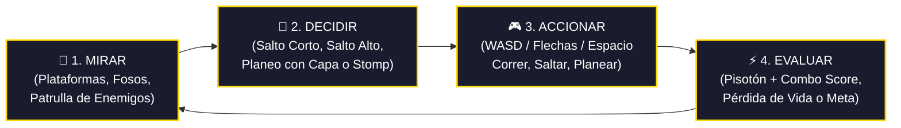
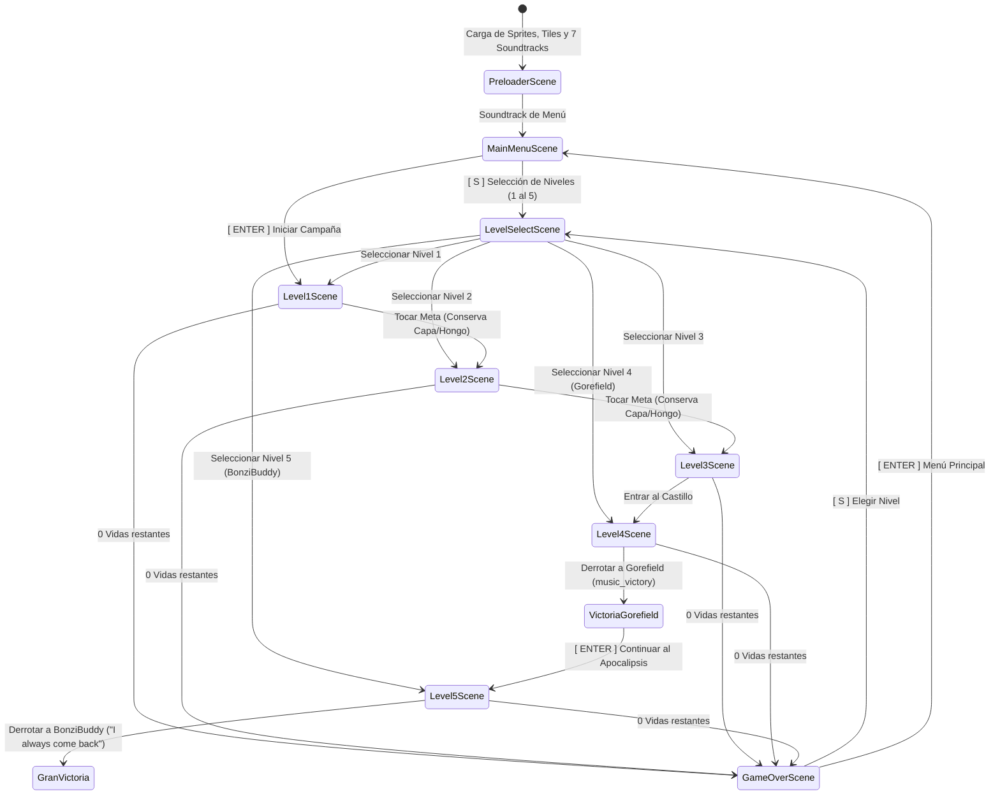

# 🍄 Super Mario Phaser Demo vs. Gorefield — Presentación Oficial del Proyecto

---

## 📌 Diapositiva 1: Portada y Stack Tecnológico

### **Desarrollo de Videojuego de Plataformas 2D con Phaser 3 & ES Modules**

> **Proyecto:** Super Mario World Demo — *La Pesadilla de Gorefield & El Apocalipsis de BonziBuddy*  
> **Tipo:** Prototipo modular de plataformas 2D con progresión de 5 niveles, selección de nivel, sistema de vidas, puntuación, soundtracks dedicados y 2 Jefes Finales.  
> **Estilo Visual & Sonoro:** Retro Pixel-Art con renderizado nítido (`pixelArt: true`) y soundtracks dedicados por zona y pantallas.

```text
  ██████╗ ██╗  ██╗ █████╗ ███████╗███████╗██████╗     ██████╗ 
  ██╔══██╗██║  ██║██╔══██╗██╔════╝██╔════╝██╔══██╗    ╚════██╗
  ██████╔╝███████║███████║███████╗█████╗  ██████╔╝     █████╔╝
  ██╔═══╝ ██╔══██║██╔══██║╚════██║██╔══╝  ██╔══██╗    ██╔═══╝ 
  ██║     ██║  ██║██║  ██║███████║███████╗██║  ██║    ███████╗
  ╚═╝     ╚═╝  ╚═╝╚═╝  ╚═╝╚══════╝╚══════╝╚═╝  ╚═╝    ╚══════╝
  [ MARIO PLATFORMER: 5 NIVELES + SOUNDTRACKS + 3 VIDAS + GOREFIELD & BONZIBUDDY ]
```

### 🛠️ Stack Tecnológico Seleccionado
| Tecnología | Función en el Proyecto | Implementación Concreta |
| :--- | :--- | :--- |
| **Phaser 3.80+** | Motor de Videojuegos 2D | Sistema **Arcade Physics** (`gravity.y: 900`), Web Audio API, colisiones y grupos estáticos. |
| **JavaScript Modular (ESM)** | Arquitectura de Código | Modularidad nativa con `import/export`, clase base [`BaseLevelScene`](file:///c:/Juegos/alban-dorian-jueg-Gr3/mi-primer-juego/src/game/scenes/BaseLevelScene.js) y persistencia de estado. |
| **Web Audio / Soundtracks** | Paisaje Sonoro Adaptativo | 7 pistas dinámicas: `music_menu`, `music_levels`, `music_castle`, `music_boss`, `music_victory`, `music_apocalypse` y `music_gameover`. |
| **Vite / Local Server** | Entorno de Desarrollo | Servidor local ligero compatible con políticas de seguridad CORS para módulos y audio. |
| **GitHub Pages** | Despliegue en Producción | Alojamiento en CDN global con rutas relativas seguras (`./assets/...`). |
| **HTML5 Canvas / CSS3** | Contenedor & Escalado | Modo `Scale.FIT` con centrado automático `CENTER_BOTH` y renderizado pixelado. |

---

## 🔄 Diapositiva 2: Visión General y Ciclo de Juego

### **Objetivo del Juego**
Superar una aventura de **5 niveles progresivos y desafiantes**, gestionando un banco de **3 vidas** y acumulando puntuación. El jugador debe dominar los power-ups clásicos (**Hongo de Crecimiento** 🍄 y **Pluma con Capa de Mario World** 🪶), cuyos efectos se conservan entre niveles, hasta infiltrarse en el Castillo de Lava para **destruir a la pesadilla GOREFIELD**, y luego adentrarse en la Tierra Devastada para enfrentar a la amenaza digital final: **BONZIBUDDY (Ojos Rojos)**.

### 🔁 El Ciclo de Juego de Plataformas (Game Loop a 60 FPS)



1. **Mirar (Percepción):** El jugador identifica la cadencia de salto de los Paragoombas, la velocidad de los guardias rojos o las bolas de fuego de Gorefield.
2. **Decidir (Táctica):** ¿Hacer un salto corto controlado? ¿Usar el planeo de la capa para sobrevolar un foso mortal? ¿Encadenar pisotones para multiplicar el puntaje?
3. **Accionar (Ejecución):** Respuesta de control milimétrica sin latencia, salto variable y planeo aéreo.
4. **Evaluar (Resultado):** Destrucción de enemigos con puntos (`+100` a `+800`), recolección de power-up (+250/+300), descuento de vida o avance de nivel.

---

## 🏗️ Diapositiva 3: Arquitectura de Escenas

### **Flujo Modular de Estados en Phaser 3**
La arquitectura desacoplada permite que cada nivel herede la física, controles, sonido, puntaje y persistencia desde [`BaseLevelScene`](file:///c:/Juegos/alban-dorian-jueg-Gr3/mi-primer-juego/src/game/scenes/BaseLevelScene.js), incorporando un **Menú de Selección de Niveles** y una pantalla de **Game Over**:



### 📂 Desglose de Escenas y Responsabilidades
* **[`config.js`](file:///c:/Juegos/alban-dorian-jueg-Gr3/mi-primer-juego/src/game/config.js):** Registro de las 9 escenas del juego, configuración Arcade Physics y resolución panorámica.
* **[`PreloaderScene.js`](file:///c:/Juegos/alban-dorian-jueg-Gr3/mi-primer-juego/src/game/scenes/PreloaderScene.js):** Carga de texturas (`bonzi_red`, `gorefield`, `player`, `enemy`) y de los 7 soundtracks (`music_menu`, `music_levels`, `music_castle`, `music_boss`, `music_victory`, `music_apocalypse`, `music_gameover`).
* **[`MainMenuScene.js`](file:///c:/Juegos/alban-dorian-jueg-Gr3/mi-primer-juego/src/game/scenes/MainMenuScene.js):** Menú oscuro de horror y apocalipsis con soundtrack dedicado (`music_menu`), siluetas de ruinas, Mario y ambos jefes acechando en las sombras, acceso directo a jugar [ENTER] o selector de 5 niveles [S].
* **[`LevelSelectScene.js`](file:///c:/Juegos/alban-dorian-jueg-Gr3/mi-primer-juego/src/game/scenes/LevelSelectScene.js):** Menú interactivo con tarjetas de los 5 niveles para salto directo o pruebas.
* **[`GameOverScene.js`](file:///c:/Juegos/alban-dorian-jueg-Gr3/mi-primer-juego/src/game/scenes/GameOverScene.js):** Pantalla de fin de partida al agotar las 3 vidas, con soundtrack fúnebre y opciones de reintento.
* **[`BaseLevelScene.js`](file:///c:/Juegos/alban-dorian-jueg-Gr3/mi-primer-juego/src/game/scenes/BaseLevelScene.js):** Clase base: persistencia de vidas/puntaje/capa, HUD en tiempo real, detección de bordes en enemigos y reproductor de música adaptativo.
* **[`Level1Scene.js`](file:///c:/Juegos/alban-dorian-jueg-Gr3/mi-primer-juego/src/game/scenes/Level1Scene.js):** Praderas desafiantes (Tutorial interactivo, saltadores y guardias).
* **[`Level2Scene.js`](file:///c:/Juegos/alban-dorian-jueg-Gr3/mi-primer-juego/src/game/scenes/Level2Scene.js):** Cavernas y alturas (Rutas no lineales con Hongo y Pluma secreta).
* **[`Level3Scene.js`](file:///c:/Juegos/alban-dorian-jueg-Gr3/mi-primer-juego/src/game/scenes/Level3Scene.js):** Puente del abismo (Modo experto con 11 enemigos de élite y fosos).
* **[`Level4Scene.js`](file:///c:/Juegos/alban-dorian-jueg-Gr3/mi-primer-juego/src/game/scenes/Level4Scene.js):** Castillo de lava, arena cerrada, combate contra Gorefield (6 HP), fanfarria de victoria y transición al Nivel 5.
* **[`Level5Scene.js`](file:///c:/Juegos/alban-dorian-jueg-Gr3/mi-primer-juego/src/game/scenes/Level5Scene.js):** Tierra apocalíptica (3400 px), ruinas calcinadas, obstáculos extremos, soundtrack melancólico/esperanzador y combate contra el Jefe Final BonziBuddy (Ojos Rojos, 7 HP) con su frase *"I always come back"*.

---

## 📷 Diapositiva 4: Mundo vs. Pantalla, Cámara y HUD

### **Resolución de Pantalla (Viewport) vs. Límites del Mundo**
* **Resolución de Pantalla (Viewport):** $800 \times 450\text{ px}$ (Panorámico 16:9).
* **Dimensiones del Mundo (World Bounds):**
  * Nivel 1: $1800 \times 450\text{ px}$
  * Nivel 2: $2200 \times 450\text{ px}$
  * Nivel 3: $2500 \times 450\text{ px}$
  * Nivel 4: $2400 \times 450\text{ px}$
  * Nivel 5: $3400 \times 450\text{ px}$ (El nivel más extenso y desafiante)

```text
┌────────────────────────────────────────────────────────────────────────┐
│ MUNDO DEL CIRCUITO / NIVEL: Hasta 3400 x 450 px                        │
│                                                                        │
│            ┌────────────────────────┐                                  │
│            │ VIEWPORT: 800 x 450 px │                                  │
│            │  [ Mario ] ──> Cámara   │  [ HUD INMÓVIL ]                 │
│            │  (startFollow suave)   │  ❤️ x3 | SCORE: 001200 | NIVEL 5 │
│            └────────────────────────┘                                  │
│   [Fosos Radiactivos]         [Plataformas Ruinas]        [Jefe Final] │
└────────────────────────────────────────────────────────────────────────┘
```

### 🎥 Seguimiento Suave de Cámara e Inmovilidad del HUD
* **Seguimiento con interpolación lineal (Lerp):**
  ```javascript
  this.cameras.main.setBounds(0, 0, worldWidth, worldHeight);
  this.cameras.main.startFollow(this.player, true, 0.08, 0.08);
  ```
* **HUD Estático y Reactivo (`scrollFactor: 0`):**
  Se fija al cristal de la pantalla mostrando en tiempo real las vidas (`❤️ x3`), el puntaje acumulado y el nivel actual:
  ```javascript
  this.hudText = this.add.text(16, 16, '', { ... }).setScrollFactor(0).setDepth(100);
  ```

---

## ⚙️ Diapositiva 5: Físicas y Mecánicas de Plataformas

### **Motor Arcade Physics con Salto Dinámico**
* **Gravedad Mundial:** $g = 900\text{ px/s}^2$.
* **Velocidad de Carrera:** $200\text{ px/s}$ (aumenta a $230\text{ px/s}$ con Hongo).

### 🦘 Salto Variable Dinámico (Sensación Super Mario World)
La altura del salto depende de cuánto tiempo el jugador sostiene el botón:

$$h_{\text{max}} = \frac{v_0^2}{2g} = \frac{(-500)^2}{2 \times 900} \approx 138.8\text{ píxeles}$$

```javascript
// Salto inicial
if (jumpPressed && canJump) {
    this.player.setVelocityY(this.isPoweredUp ? -550 : -500);
}

// Salto Variable: soltar el botón corta el ascenso inmediatamente
if (!jumpPressed && this.player.body.velocity.y < -120) {
    this.player.setVelocityY(this.player.body.velocity.y * 0.7);
}
```

### 🪶 Mecánica de Planeo de la Capa (*Cape Glide*)
Al equipar la Pluma, mantener presionado salto en el aire reduce la gravedad a un planeo suave ($65\text{ px/s}$):

```javascript
const isFalling = this.player.body.velocity.y > 0;
const canGlide = this.hasCape && !canJump && jumpPressed && isFalling;

if (canGlide) {
    this.player.setVelocityY(65); // Caída lenta terminal (Glide)
    if (cursors.left.isDown)  this.player.setVelocityX(-220);
    if (cursors.right.isDown) this.player.setVelocityX(220);
}
```

---

## 🛑 Diapositiva 6: Sistema de Reglas, Vidas y Power-Ups

### **1. Sistema de 3 Vidas, Jerarquía de Daño y Game Over**
* El jugador inicia con **3 Vidas (`lives = 3`)**.
* **Jerarquía de Daño Clásica (Fiel a Super Mario):**
  * **Con Capa 🪶:** Un impacto lateral o proyectil **retira la Capa** (`hasCape = false`), conservando el tamaño aumentado si tenía Hongo. Otorga un salto de retroceso y **1.5 segundos de invulnerabilidad con parpadeo**.
  * **Con Hongo 🍄:** Un impacto lateral **encoge a Mario** a su forma pequeña (`isPoweredUp = false`, escala `1.0`), otorgando retroceso y **1.5 segundos de invulnerabilidad**.
  * **Mario Pequeño:** Al no tener power-ups, el impacto lateral **descuenta 1 Vida** (`lives--`). Si llega a 0 vidas, transiciona a [`GameOverScene`](file:///c:/Juegos/alban-dorian-jueg-Gr3/mi-primer-juego/src/game/scenes/GameOverScene.js).
  * **Caída al Vacío:** Caer fuera de los límites inferiores siempre descuenta 1 vida directamente, fiel a los juegos de plataformas.

### **2. Persistencia Total de Power-Ups entre Niveles**
Si Mario obtiene el Hongo 🍄 o la Capa 🪶 en el Nivel 1 o Nivel 2, **comienza el siguiente nivel con dicho power-up ya equipado**, permitiéndole planear o resistir desde el primer segundo:

```javascript
// En BaseLevelScene al tocar la bandera de meta:
this.scene.start(nextLevelKey, {
    lives: this.lives,
    score: this.score + 1000,
    isPoweredUp: this.isPoweredUp, // Persiste estado de Hongo
    hasCape: this.hasCape          // Persiste estado de Capa
});
```

### **3. Detección Inteligente de Bordes en Enemigos (*Edge Detection*)**
Los enemigos escanean el suelo a 6 píxeles por delante de sus pies antes de avanzar. Si la plataforma termina, **invierten su dirección automáticamente**, evitando caídas accidentales.

### **4. Sistema de Checkpoints en Batallas de Jefes (Gorefield y BonziBuddy)**
* Al alcanzar la antesala del Nivel 4 ($x = 1270$) o del Nivel 5 ($x = 2500$), se activa un **Checkpoint automático**.
* Si el jugador es derrotado dentro de la arena de combate por Gorefield o BonziBuddy, **reaparece inmediatamente un paso antes de entrar a la arena**, con una estación de recarga de power-ups (Hongo y Pluma) a su disposición, sin necesidad de rehacer el nivel completo.
* El checkpoint se conserva tanto al perder vidas individuales como al reintentar desde la pantalla de Game Over.

### **5. Sistema Universal de Pausa y Menú de Control en Todos los Niveles**
* **Acceso Inmediato e Intuitivo:** Implementado transversalmente en [`BaseLevelScene`](file:///c:/Juegos/alban-dorian-jueg-Gr3/mi-primer-juego/src/game/scenes/BaseLevelScene.js), activo en los 5 niveles del juego.
* **Múltiples Métodos de Activación:** Mediante botón interactivo en el HUD (`⏸️ PAUSA`) situado en la esquina superior derecha o mediante teclado con las teclas rápidas **`P`** o **`ESC`**.
* **Congelamiento Completo:** Congela el motor de físicas (`physics.world.pause()`), proyectiles, timers y animaciones del jugador y enemigos.
* **Menú Flotante con Tres Opciones Tácticas:**
  * **`▶️ [ CONTINUAR ]`**: Reanuda inmediatamente la partida y las físicas sin saltos ni penalizaciones.
  * **`🔄 [ REINICIAR NIVEL ]`**: Reinicia el escenario actual (preservando el checkpoint de jefe si ya fue alcanzado).
  * **`🏠 [ MENÚ PRINCIPAL ]`**: Detiene los sonidos y retorna limpiamente a [`MainMenuScene`](file:///c:/Juegos/alban-dorian-jueg-Gr3/mi-primer-juego/src/game/scenes/MainMenuScene.js).

---

## 🗺️ Diapositiva 7: Diseño de Niveles, Jefes y Soundtracks

### **Rutas de Audio Establecidas en `assets/sounds/`**
1. **`music_menu.mp3`**: Soundtrack retro optimista para el Menú Principal y Selección de Nivel.
2. **`music_levels.mp3`**: Soundtrack clásico de praderas para los Niveles 1 y 2.
3. **`music_castle.mp3`**: Marcha fúnebre y oscura para el Nivel 3 (Puente al Castillo) y el calabozo del Nivel 4.
4. **`music_boss.mp3`**: Ritmo acelerado y frenético para las batallas de jefes (Gorefield y BonziBuddy).
5. **`music_victory.mp3`**: Fanfarria triunfal de victoria al destruir a Gorefield o vencer el juego.
6. **`music_apocalypse.mp3`**: Melodía nostálgica y esperanzadora en escala menor para el Nivel 5 devastado.
7. **`music_gameover.mp3`**: Jingle melancólico descendente al agotarse las 3 vidas.
8. **`music_akatsuki.mp3`**: Marcha mística, solemne y ritualística con campana budista (*Bonshō*), flauta tradicional *Shakuhachi*, cantos corales oscuros (*estilo Girei*) y tambores *Taiko*, exclusiva para la derrota de BonziBuddy y el Teaser de los Akatsuki.

### **Efectos de Sonido (SFX Clásicos)**
* **`sfx_jump.mp3`**: Salto retro dinámico con barrido ascendente de frecuencia (140 Hz a 620 Hz).
* **`sfx_powerup.mp3`**: Arpegio staccato ascendente de 7 notas al recolectar el Hongo 🍄.
* **`sfx_cape.mp3`**: Remolino sonoro y repique brillante de campanas mágicas al adquirir la Pluma con Capa 🪶.

### 🎬 Cinemática de Presentación de Jefes (5 Segundos)
* **Formato Cinematográfico Letterbox:** Al entrar a la arena de Gorefield o BonziBuddy, franjas negras cinematográficas se deslizan en los extremos superior e inferior.
* **Bloqueo Inmune Temporal:** Durante exactamente 5 segundos, Mario y el jefe quedan inmovilizados sin recibir ni infligir daño mientras suena la música de combate.
* **Tarjeta de Presentación y Cuenta Regresiva:** Un cartel arcade presenta el nombre y frase del jefe, junto con una cuenta regresiva dinámica (`5... 4... 3... 2... 1... ¡A LUCHAR!`).
* **Inicio Explosivo:** Cumplidos los 5 segundos, las barras se retiran, se activan los controles del jugador y se despliega la barra de vida para comenzar el combate.

### 🌟 Secreto del Nivel 4: Bóveda Sagrada de Lasaña Dorada
* **Descubrimiento por Vuelo o Salto:** Oculto en el techo de la caverna ($y \le 85$, entre $x = 650$ y $880$), accesible planeando con la Capa 🪶 o revelando un bloque misterioso invisible en $x = 520, y = 175$.
* **Recompensa Legendaria:**
  * **+1 Vida Extra** inmediata (`lives++`).
  * **+5000 Puntos** de bonificación.
  * **Máximo Poder Automático:** Equipa de inmediato el Hongo 🍄 y la Pluma con Capa 🪶.
  * Destello dorado de pantalla completa con partículas de victoria.

### 👹 Jefe 1: GOREFIELD (Nivel 4 - 6 HP) — Dinamismo Extremo
* **Cinemática de Entrada:** 5 segundos de presentación dramática antes de iniciar el combate.
* **Anti-Exploit de Pisotón Continuo (Teletransportación Inmediata):** Tras recibir un pisotón, Gorefield se desvanece instantáneamente en llamas y se teletransporta a un punto aleatorio distante de la arena ($> 260\text{ px}$ o plataformas elevadas), impidiendo rebotar repetidamente en el mismo sitio.
* **Anillo Radial de Bombas en 360°:** En el momento exacto del pisotón, Gorefield expulsa una corona expansiva de 8 a 12 bolas de fuego que cubren los 360 grados, obligando al jugador a maniobrar en el aire y no quedarse suspendido.
* **Bombas de Cráter y Destrucción del Piso:** Lanza morteros pesados de lava que al estrellarse destruyen baldosas del suelo. Además, en transiciones de fase (HP = 4 y HP = 2), desata colapsos sísmicos telegrafiados que hunden sectores enteros del piso abriendo abismos letales directos al vacío.
* **Invocación de Esbirros de Lava:** En HP = 4 y HP = 2 convoca engendros saltadores de fuego para forzar combate multifoco.
* **IA Ágil y Evasión de Fosos:** Detecta los fosos destruidos y salta ágilmente sobre ellos (`vy = -440`) para perseguir al jugador sin caer en sus propias trampas.
* **Recompensa:** $+5000\text{ pts}$ al destruirlo, fanfarria `music_victory` y pantalla de transición al Nivel 5.

### 🟣 Jefe Final: BONZIBUDDY OJOS ROJOS (Nivel 5 - 7 HP) — Dificultad Pesadilla
* **Fondo Exclusivo de la Luna Roja (Rinne Sharingan):** Al entrar a la arena de BonziBuddy, el fondo del nivel se transforma en un cielo carmesí presidido por una gigantesca **Luna Roja de Ojos Malditos** (`red_moon.png`), con resplandor de eclipse pulsante y rotación lenta. Este fondo es 100% exclusivo de la batalla final contra BonziBuddy.
* **Cinemática de Entrada:** 5 segundos de presentación dramática con cuenta regresiva.
* **Efecto Glitch de Virus en el Sprite tras Pisotón:** Cada vez que Mario le propina un pisotón a BonziBuddy, su sprite experimenta un colapso digital espasmódico e instantáneo: aberración cromática RGB con clones fantasma en cian y magenta, cortes y tiras de escaneo horizontal (*scanline slice glitch*), deformación y sacudida de escala horizontal, parpadeo estroboscópico de tintes de virus (cian, fucsia, verde matriz, blanco estático), fuga de glifos de código corrupto (`01`, `ERR`, `404`, `VIRUS`) y audio sintético de fallo de memoria (*bitcrush glitch*), consolidando su naturaleza de entidad cibernética corrupta.
* **Anti-Exploit Glitch (Teletransporte Cuántico):** Tras el glitch del pisotón, BonziBuddy sufre un error de fragmentación y se teletransporta a la plataforma más distante o extremo opuesto de la arena, rompiendo cualquier combo de rebote.
* **Anillo Radial Glitch en 360°:** Despacha una descarga circular de 8 a 12 orbes de virus púrpura/cian en todas las direcciones tridimensionales para castigar la estancia aérea estática.
* **Deleción de Bloques y Desintegración de Memoria:** Dispara bombas de corrupción cuántica que borran permanentemente bloques del piso. A 5 HP y 3 HP activa alertas telegrafiadas (`ERROR 404: SECTOR BORRADO`) que desintegran franjas completas abriendo fosas radiactivas al vacío mortal.
* **Invocación de Agentes Virales:** Despliega esbirros ciber-glitch veloces y agresivos que patrullan y asedian a Mario.
* **Fase Crítica (HP <= 2):** Sobrecarga de velocidad extrema ($190\text{ px/s}$), ráfagas dobles y teletransportes frenéticos.
* **Frase Icónica de Derrota y Revelación:** Al vaciar sus 7 HP, se congela temblando y pronuncia:
  > **❝ I always come back ❞**
  seguido de su implosión, el inicio del nuevo soundtrack cinematográfico misterioso `music_akatsuki` y la **Pantalla de Epílogo con Teaser de los Akatsuki** (anunciando la llegada de la temida organización ninja de 10 renegados para la siguiente demo).
* **Escenario de Pelea 100% Despejado (Luna Roja Visible):** A diferencia de un cuadro opaco tradicional que tape la pantalla, el mensaje final y teaser se proyectan en un encuadre panorámico letterbox (*cinematic borders* superior e inferior). Al caer BonziBuddy, **todos los bloques de plataformas flotantes y muros de la arena se desintegran en partículas glitch y se eliminan por completo**, permitiendo admirar la imponente Luna Roja de Ojos Malditos, el cielo carmesí de eclipse y el horizonte apocalíptico sin ningún obstáculo visual.

---

## 🚀 Diapositiva 8: Despliegue y Conclusión

### **Flujo de Trabajo Git & GitHub Pages**
1. **Control de Versiones Atómico:** Commits semánticos para audio, vidas, menú y jefe.
2. **Compatibilidad Total de Rutas Relativas:** Carga mediante `./assets/...` para funcionar tanto en servidor local como en el subdirectorio de GitHub Pages:
   `https://2026B-sof-jueg-gr1.github.io/alban-dorian-jueg-Gr3/mi-primer-juego/`

```bash
git add .
git commit -m "feat: integracion de 4 soundtracks, 3 vidas, game over, seleccion de nivel y persistencia"
git push origin main
```

### 📈 Métricas de Rendimiento Técnicas
| Parámetro | Objetivo | Rendimiento Obtenido |
| :--- | :---: | :---: |
| **Fluidez de Render** | $60\text{ FPS}$ constantes | **$60\text{ FPS}$ sin caídas** |
| **Latencia de Audio** | $< 50\text{ ms}$ | **Instantánea** (Web Audio buffer) |
| **Tiempo de Carga Total** | $< 1.5\text{ s}$ | **$\approx 0.6\text{ s}$** con assets y audio |
| **Consumo de Memoria** | $< 120\text{ MB}$ | **$\approx 52\text{ MB}$** con música y físicas |

### 🎯 Conclusión
El proyecto integra con éxito la experiencia retro de plataformas de **Super Mario World** con la innovación de un combate contra un jefe monstruoso (**Gorefield**), respaldado por una **arquitectura modular profesional en Phaser 3**, persistencia de estado global y sonido adaptativo listo para jugar en la web.
